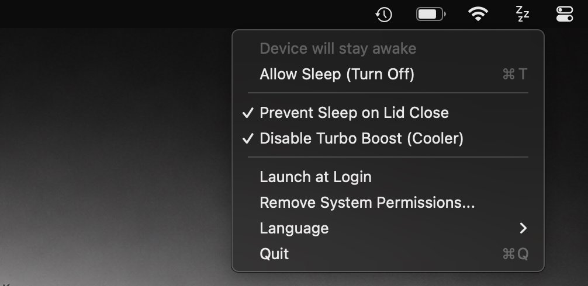

# StayAwake

A lightweight macOS menu bar utility to keep your Mac awake (`caffeinate`), manage `System SleepDisabled` (`pmset -a disablesleep`), and toggle Intel Turbo Boost (`DisableTurboBoost.64bits.kext`)—all from a single `Zzz` menu bar icon.



## Features

- **Left-Click Toggle (`caffeinate`):** Instantly enable/disable `caffeinate -i -m -s` without any password prompt.
- **Right-Click Menu:**
  - **System SleepDisabled:** Toggle `pmset -a disablesleep 1/0` so closing the lid does not put your Mac to sleep.
  - **Disable Turbo Boost:** Load/unload `DisableTurboBoost.64bits.kext` to keep Intel MacBooks cooler.
  - **Launch at Login:** Automatically start StayAwake when you log in (`~/Library/LaunchAgents/com.rizki.StayAwake.plist`).
- **One-Time Password Setup:** Automatically configures `/etc/sudoers.d/stayawake` on first privileged action so subsequent toggles require **no password**.

## Requirements

- macOS (tested on macOS 13 Ventura, Intel x86_64)
- Xcode Command Line Tools (`swiftc`) to build from source
- *(Optional for Turbo Boost toggle)* `DisableTurboBoost.64bits.kext` placed in `StayAwake.app/Contents/Resources/` (or `/Applications/Turbo Boost Switcher.app`)

## Build

```bash
chmod +x build.sh
./build.sh
open StayAwake.app
```

## Notes on Turbo Boost

macOS requires third-party kernel extensions to be authorized once in **System Settings → Privacy & Security** (click **Allow** and restart) before `kextload` can load `DisableTurboBoost.64bits.kext`.

## Credits

- `DisableTurboBoost.64bits.kext` is from [Turbo Boost Switcher](https://github.com/rugarciap/Turbo-Boost-Switcher) by Rubén García Pérez.
